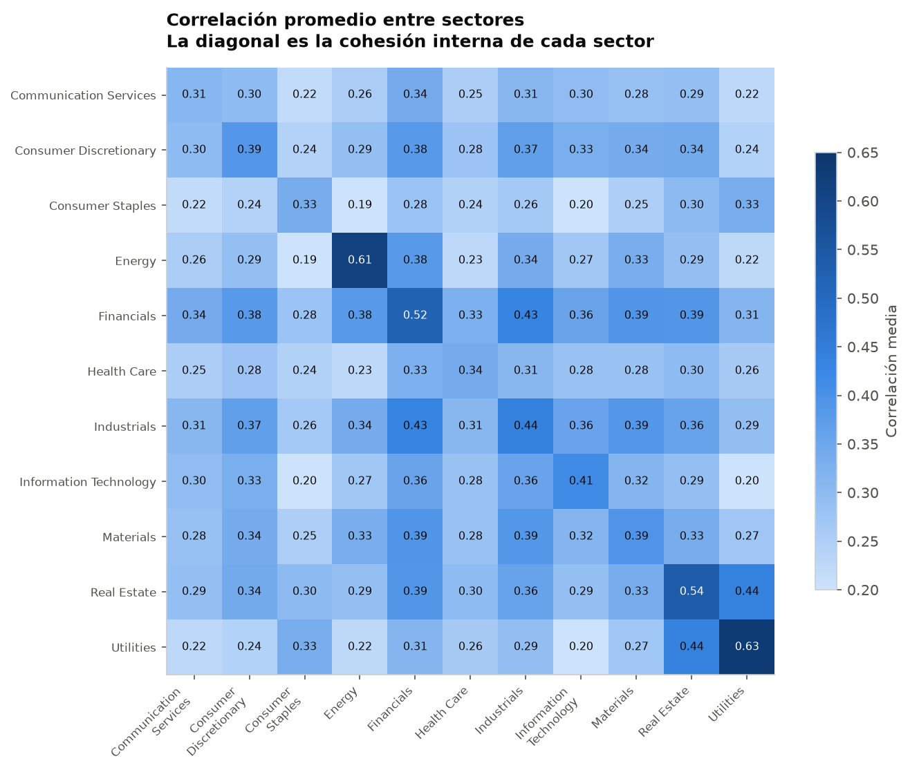
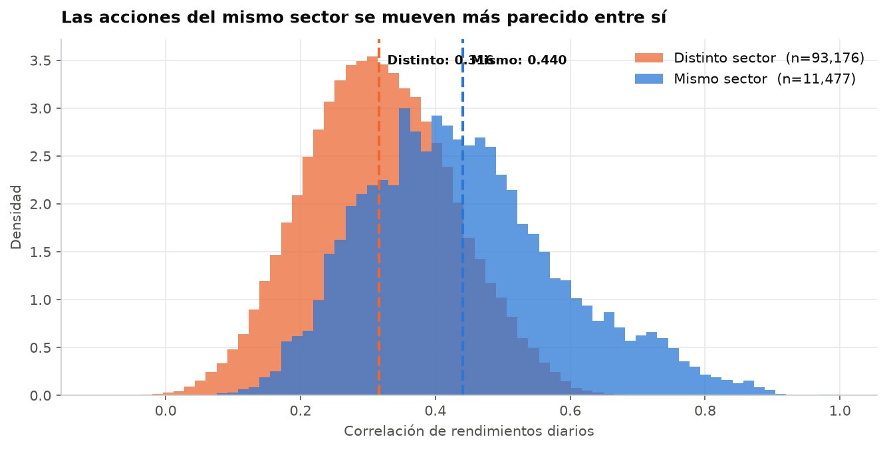

**Materia:** Datos Masivos · **Profesor:** Oscar Enrique Landivar Carrasco · **Semestre:** Séptimo
semestre

# Correlación entre acciones del S&P 500

Motor de análisis de estructura de correlación y riesgo para los componentes del S&P 500,
inspirado en la capa analítica de plataformas de gestión de riesgo como Aladdin (BlackRock).

**Entregable 1** ✅ — Definición del problema, fuentes de datos y repositorio reproducible
**Entregable 2** ✅ — Data lake en Databricks, universo ampliado y motor de riesgo
([detalle](docs/ENTREGABLE_2.md))

---

## El problema

Cuando se construye un portafolio, el riesgo total **no es la suma de los riesgos individuales**:
depende de cómo se mueven los activos entre sí. Dos acciones que suben y bajan al mismo tiempo no
diversifican nada — es como tener una sola posición del doble de tamaño.

Con 500 acciones hay **más de 124,000 pares** que evaluar, y el número crece con el cuadrado del
universo. Medir esa estructura de co-movimiento, y entender de dónde viene, es el problema central
de la gestión de riesgo cuantitativa.

### La pregunta del Entregable 1

> **¿Las acciones del mismo sector GICS están más correlacionadas entre sí que con acciones de
> otros sectores, y qué tan grande es esa diferencia?**

---

## Hallazgos del Entregable 1

**Sí, y la diferencia es sustancial.**

| Grupo | Pares | Correlación media |
|---|---|---|
| **Mismo sector** | 11,477 | **0.440** |
| **Distinto sector** | 93,176 | **0.316** |

El co-movimiento dentro de un sector es **1.39 veces** el que hay entre sectores distintos, medido
sobre 104,653 pares únicos y 11.6 años de rendimientos diarios.



**Lo que valida el resultado.** Los pares con mayor correlación son exactamente los que deberían
ser: `GOOG`–`GOOGL` (0.995) y `NWS`–`NWSA` (0.972) son las dos clases de acción de la *misma
empresa*. Después vienen vínculos económicos genuinos — `AMAT`–`LRCX` (equipo para
semiconductores), `FITB`–`RF`–`CFG`–`KEY` (bancos regionales), `MET`–`PRU` (aseguradoras de vida).

**Lo más interesante está fuera de la diagonal.** *Real Estate* y *Utilities* correlacionan 0.44
entre sí, muy por encima del promedio inter-sectorial: son los dos sectores más sensibles a las
tasas de interés. La clasificación GICS los separa, pero el riesgo no.

**Lo que todavía NO se puede concluir.** La correlación cruda mezcla dos efectos: que todo el
mercado se mueve junto, y que dos empresas tienen un vínculo real. Que la correlación media *entre
sectores distintos* sea 0.32 —y no cerca de cero— es precisamente la huella de ese factor común.
Separarlos es el objetivo del Entregable 2.



---

## Hallazgos del Entregable 2

El detalle completo está en **[`docs/ENTREGABLE_2.md`](docs/ENTREGABLE_2.md)**. Lo esencial:

**La correlación de 0.316 entre sectores distintos era el factor de mercado.** Al separarlo, el
vínculo sectorial sobrevive entre 0.30 y 0.38: era real, no un reflejo del movimiento común.

**Las empresas chicas no dependen menos del mercado — reaccionan más.**

| Tamaño | Empresas | Beta | R² |
|---|---|---|---|
| Large | 455 | 0.859 | 0.323 |
| Mid | 317 | 1.060 | 0.359 |
| Small | 439 | **1.102** | 0.319 |

El R² es casi idéntico, pero el beta crece conforme baja el tamaño.

**Diez posiciones no son diez apuestas.** Diez bancos en partes iguales tienen 27.4% de
volatilidad; diez sectores distintos, 15.6%. Mismo número de posiciones, **43% menos riesgo**.

**La diversificación se rompe con la turbulencia, no con las caídas.** La cohesión del mercado
correlaciona +0.755 con la volatilidad del mes y solo −0.259 con su rendimiento. Pánico y euforia
mueven todo junto por igual.

**Un motor calibrado con toda la historia subestima el riesgo en 29% durante las crisis**, que es
justo cuando alguien lo consulta.

---

## Fuentes de datos

Tres fuentes, **todas obtenidas mediante código**: dos por API/librería y una por scraping.

| # | Fuente | Método | Variables principales | Periodo | Formato |
|---|---|---|---|---|---|
| 1 | Yahoo Finance (`yfinance`) | Librería / API | Precio de cierre **ajustado** diario por ticker | 2015-01 → actual | JSON → DataFrame → Parquet |
| 2 | [Wikipedia — S&P 500](https://en.wikipedia.org/wiki/List_of_S%26P_500_companies) | Scraping (`requests` + `read_html`) | Ticker, empresa, sector GICS, sub-industria | Composición actual | HTML → DataFrame → Parquet |
| 3 | [FRED](https://fred.stlouisfed.org/) (Fed de St. Louis) | API REST con llave | VIX, tasa del Tesoro a 10 años | 2015-01 → actual | JSON → DataFrame → Parquet |

**Volumen procesado:**

| | Universo | Observaciones |
|---|---|---|
| Entregable 1 | S&P 500 (503 tickers) | 1.48 millones |
| Entregable 2 | **S&P Composite 1500** (1,503 tickers) | **4.1 millones** |

El Entregable 2 amplía a los tres índices por capitalización (500 large + 400 mid + 600 small)
reutilizando el mismo scraping. La columna nueva `cap_tier` es la que habilita preguntar si el
tamaño de la empresa cambia su relación con el mercado.

---

## Cómo ejecutarlo

Requiere **Python 3.12 o superior** (`numpy==2.5.2` no instala en versiones anteriores). Los
comandos funcionan en cualquier computadora, sin modificar nada: el proyecto **no contiene ninguna
ruta personal**.

**0. Revisa tu versión de Python**

```bash
python3 --version
```

Si el resultado es menor a 3.12, instala una versión más nueva antes de continuar:

- **macOS (Homebrew):** `brew install python@3.12`, luego usa `python3.12` en vez de `python3` en
  el paso 3.
- **Windows/Linux:** descarga el instalador desde [python.org/downloads](https://www.python.org/downloads/).

> Si te saltas este paso, el paso 3 falla con un error como
> `ERROR: Could not find a version that satisfies the requirement numpy==2.5.2`. No es que algo
> esté mal configurado: simplemente tu Python es demasiado viejo para estas dependencias.

**1. Clonar el repositorio**

```bash
git clone https://github.com/0263389/datos-masivos-correlacion-sp500.git
```

**2. Entrar a la carpeta**

```bash
cd datos-masivos-correlacion-sp500
```

**3. Crear el entorno virtual e instalar las dependencias**

```bash
python3 -m venv .venv && ./.venv/bin/python -m pip install -r requirements.txt
```

Si `python3` apunta a una versión vieja, reemplázalo por la versión que instalaste en el paso 0
(por ejemplo `python3.12 -m venv .venv`).

**4. Abrir el notebook**

```bash
./.venv/bin/python -m jupyter lab notebooks/01_entregable1.ipynb
```

> ⚠️ **Importante: selecciona el kernel correcto.** Al abrir el notebook, elige el intérprete de
> `.venv`, no el Python del sistema ni el de Anaconda. En VS Code se hace con *Select Kernel →
> Python Environments → .venv*. Si eliges el equivocado, verás `ModuleNotFoundError: No module
> named 'yfinance'` aunque las librerías estén instaladas.
>
> Si tienes Anaconda instalado, su kernel puede tomar prioridad. Para forzar el del proyecto:
>
> ```bash
> ./.venv/bin/python -m ipykernel install --prefix=./.venv --name python3
> ```

**El notebook se ejecuta completo sin configuración adicional.** No hace falta ninguna llave de
API: `data/processed/` incluye un respaldo comprimido de los datos, y el código lo usa
automáticamente si la descarga en vivo falla.

### Entregable 2: el data lake en Databricks

El Entregable 1 corre completo en tu máquina. El Entregable 2 vive en Databricks, porque los datos
son tablas Delta en Unity Catalog.

**1.** Crea una cuenta gratuita en [Databricks Free Edition](https://www.databricks.com/learn/free-edition).

**2.** Conecta tu cuenta de GitHub: *tu perfil → Settings → Linked accounts → GitHub*.

**3.** Trae el repositorio: *Workspace → Create → Git folder*, con la URL de este repositorio.

**4.** Corre los notebooks de `databricks/` **en orden**, del 01 al 06. Cada capa depende de la
anterior.

> ⚠️ **Elige *General compute → Serverless***, no un SQL warehouse. Un warehouse solo ejecuta
> celdas SQL y las de Python fallan.

> **Sobre el formato de los notebooks de Databricks.** Se entregan como archivos `.py`
> (*Databricks notebook source*), no como `.ipynb`. Eso significa que **no traen las salidas
> incrustadas**: al abrirlos en GitHub se ve el código, no los resultados.
>
> Es una decisión deliberada y es consecuencia directa de la regla que el propio proyecto adoptó en
> el Entregable 1. Un `.ipynb` es un JSON donde cada ejecución reescribe miles de líneas —las
> salidas, los contadores, las imágenes en base64— así que dos personas que lo corran generan un
> conflicto de fusión irresoluble. Con cuatro integrantes eso era inviable. Los `.py` son texto
> plano: Git los fusiona, se pueden revisar línea por línea en un *diff*, y se editan desde VS Code
> igual que cualquier otro archivo.
>
> El costo de esa decisión es que los resultados no viajan dentro del archivo. Están documentados
> aparte, con sus números, en **[`docs/ENTREGABLE_2.md`](docs/ENTREGABLE_2.md)**. Para reproducirlos
> basta correr los notebooks en orden siguiendo las instrucciones de arriba.


Para correr las pruebas del motor de riesgo, que no necesitan Spark ni Databricks:

```bash
./.venv/bin/python -m pytest tests/ -v
```

---

### Opcional: datos macro frescos de FRED

FRED requiere una llave gratuita. Sin ella el notebook funciona igual (avisa y continúa).

```bash
cp .env.example .env
```

Luego abre `.env` y pega tu llave de [fredaccount.stlouisfed.org/apikeys](https://fredaccount.stlouisfed.org/apikeys).
El archivo `.env` está en `.gitignore` y **nunca debe subirse al repositorio**.

> `.env.example` también incluye `SEC_USER_AGENT`. Ningún módulo de `src/` lo usa todavía: está
> reservado para un entregable futuro que consulte SEC EDGAR. Puedes dejarlo vacío por ahora.

> ✅ **Verificado el 10 de septiembre de 2026** en macOS (Apple Silicon), clonando el repositorio
> desde cero en una computadora que no tenía el proyecto instalado y siguiendo estos pasos al pie
> de la letra. Con Python 3.9 y con Python 3.11 el paso 3 falla (`numpy==2.5.2` requiere Python
> ≥3.12); con Python 3.12 el resto de los pasos funcionó sin ajustes: instalación de dependencias
> y los cinco módulos de `src/` importan sin errores.

---

## Estructura del repositorio

```
datos-masivos-correlacion-sp500/
├── README.md                     Este archivo
├── requirements.txt              Dependencias con versiones fijadas
├── .env.example                  Variables de entorno necesarias (sin valores)
├── .gitignore                    Excluye .venv, .env, cachés y datos crudos
│
├── src/                          Código reutilizable
│   ├── config.py                 Rutas portables y parámetros del análisis
│   ├── data.py                   Extracción: Yahoo, Wikipedia, FRED, S&P 1500
│   ├── quality.py                Diagnóstico: nulos, duplicados, datos corruptos
│   ├── returns.py                Precios → panel balanceado → rendimientos log
│   ├── analysis.py               Correlación y agregación por sector
│   └── risk.py                   Covarianza, shrinkage y descomposición del riesgo
│
├── tests/
│   └── test_risk.py              25 pruebas del motor de riesgo
│
├── notebooks/                    Entregable 1 — análisis local con pandas
│   └── 01_entregable1.ipynb
│
├── databricks/                   Entregable 2 — data lake y análisis con Spark
│   ├── 01_bronze_ingesta.py      Las 3 fuentes → tablas Delta crudas
│   ├── 02_silver_limpieza.py     Auditoría y rendimientos (window functions)
│   ├── 03_gold_analisis.py       Factor de mercado, betas, residuales
│   ├── 04_benchmark_pandas_vs_spark.py
│   ├── 05_motor_de_riesgo.py     Descomposición del riesgo de portafolio
│   └── 06_regimenes_de_crisis.py Cohesión del mercado en el tiempo
│
├── docs/
│   ├── ENTREGABLE_2.md           Narrativa y hallazgos del Entregable 2
│   └── GLOSARIO.md               Términos técnicos en español llano
│
├── data/
│   ├── raw/                      Caché de trabajo (ignorado por git)
│   └── processed/                Respaldo comprimido que sí viaja con el repo
│
└── figures/                      Gráficas exportadas
```

> Los datos del Entregable 2 **no están en el repositorio**: viven como tablas Delta en Unity
> Catalog y se reconstruyen corriendo `databricks/01_bronze_ingesta`. Ese es justamente el punto de
> tener un data lake — dejamos de versionar datos.

### Por qué la lógica vive en `src/` y no en el notebook

El notebook solo orquesta y narra; toda la lógica está en funciones importables. Esto tiene tres
consecuencias prácticas:

1. **El código se puede probar.** Una función con entrada y salida es testeable; una celda no.
2. **Cuatro personas pueden trabajar en paralelo.** Los archivos `.py` son texto plano y Git los
   fusiona sin problema. Un `.ipynb` es un JSON gigante donde cualquier ejecución cambia miles de
   líneas y genera conflictos irresolubles.
3. **El proyecto es acumulativo.** El Entregable 2 agregó `src/risk.py` sin tocar nada de lo
   existente.

El Entregable 2 estuvo a punto de romper este principio: toda la matemática del motor de riesgo
quedó al inicio dentro de los notebooks de Databricks, dejando `src/` huérfano. Se refactorizó a
`src/risk.py` con pruebas, y los notebooks lo importan localizando la raíz del repositorio sin
rutas escritas a mano.

---

## Decisiones metodológicas

| Decisión | Por qué |
|---|---|
| **Rendimientos logarítmicos, no precios** | Los precios no son estacionarios. Correlacionarlos da ~0.95 entre cualquier par de empresas que hayan subido: mide la tendencia común, no el co-movimiento |
| **Precios ajustados (`auto_adjust=True`)** | Sin ajuste, un split 4:1 aparece como una caída de −75% en un día y contamina toda la matriz |
| **Panel balanceado, mínimo 2,900 días** | En un panel balanceado la longitud la impone el ticker más joven. Exigir historia casi completa cuesta 44 empresas (9%) y multiplica por cinco la historia |
| **Sin relleno hacia adelante (`ffill`)** | Inventaría días con rendimiento 0% que nunca ocurrieron y sesgaría las correlaciones a la baja |
| **Solo el triángulo superior de la matriz** | La matriz completa cuenta cada par dos veces e incluye la diagonal (siempre 1.0), inflando los promedios |
| **`BRK.B` → `BRK-B`** | Wikipedia y Yahoo usan notaciones distintas. Sin traducir, esos tickers regresan vacíos **sin error** y desaparecen en silencio |

### Detección de datos corruptos

Se encontró un caso real: **`MNST` (Monster Beverage)** oscila entre ~\$95 y ~\$47 —exactamente la
mitad— en días sueltos de 2026, regresando después. Es un split 2:1 aplicado de forma inconsistente
por la fuente.

El criterio que lo separa de un evento real es la **frecuencia**: una empresa real tiene a lo mucho
uno o dos movimientos de ±50% en once años. `MNST` tiene siete. Casos conservados por ser reales:
`PCG` (bancarrota de PG&E, 2019), `APA`/`OXY`/`TRGP` (guerra de precios del petróleo, marzo 2020),
`GL` (reporte de vendedores en corto, 2024).

> **Este criterio se corrigió en el Entregable 2.** Calibrado sobre el S&P 500 funcionaba, pero al
> ampliar a 1,500 empresas empezó a descartar eventos reales —`GME` y su *short squeeze* de 2021,
> mineras de bitcoin, biotecnológicas—. El criterio nuevo distingue por **reversión** y no por
> frecuencia: un split mal aplicado se deshace, un desplome real no.
> Ver [`docs/ENTREGABLE_2.md`](docs/ENTREGABLE_2.md#problemas-de-calidad-encontrados).

---

## Limitaciones

| Limitación | Impacto |
|---|---|
| **Sesgo de supervivencia** | Se usa la composición *actual* del índice; las empresas que quebraron o salieron no aparecen |
| **Cobertura** | 45 de 503 empresas excluidas por historia insuficiente, 1 por datos corruptos. El análisis cubre 458 |
| **Calidad de la fuente** | Yahoo Finance no es una API oficial; podría haber errores más sutiles no detectados |
| **Comparaciones múltiples** | Con 104,653 pares, cualquier prueba de significancia individual requiere corrección (Benjamini-Hochberg) |
| **Correlación ≠ causalidad** | El co-movimiento puede deberse a un tercer factor común |
| **Clases de acción duplicadas** | `GOOG`/`GOOGL` y `NWS`/`NWSA` son la misma empresa e inflan el extremo superior |

Las limitaciones propias del Entregable 2 —sesgo de supervivencia agravado en small caps, beta
medido contra un índice de igual ponderación, y una sola matriz de covarianza para once años— están
en [`docs/ENTREGABLE_2.md`](docs/ENTREGABLE_2.md#limitaciones).

---

## Hacia dónde va el proyecto

| Entregable | Qué se agregó | Dónde quedó |
|---|---|---|
| **1** ✅ | Extracción, diagnóstico, correlación por sector | `src/data.py`, `quality.py`, `returns.py`, `analysis.py` |
| **2** ✅ | Data lake medallion, universo ampliado a 1,500, factor de mercado, motor de riesgo | `databricks/01` a `06`, `src/risk.py` |
| **3** | Escenarios de estrés con correlaciones de crisis, y la red de correlación (árbol de expansión mínima sobre la matriz de distancia que ya existe) | `src/network.py` |

El Entregable 2 se desvió del plan original en dos puntos, y conviene decir por qué:

- Se usó el **promedio de igual ponderación** en lugar de PCA como factor de mercado. En la
  práctica son casi idénticos —el primer componente principal tiene todos los pesos del mismo signo
  y parecidos entre sí— pero el promedio se obtiene con un `groupBy` sobre la fecha en vez de una
  covarianza de 1,200×1,200.
- La **capa de riesgo se adelantó** del Entregable 4 al 2, porque es lo que convierte el proyecto
  de un análisis en una herramienta.

---

## Integrantes

| Nombre | Responsabilidad |
|---|---|
| Franco Rissotto | Extracción y configuración (`src/data.py`, `src/config.py`) |
| Miguel Herrera | Diagnóstico de calidad (`src/quality.py`) |
| Octavio de la Mora | Rendimientos y correlación (`src/returns.py`, `src/analysis.py`) |
| Paolo del Valle | Documentación (`README.md`) |

---

## Cómo contribuir

Reglas de trabajo en equipo para evitar conflictos y archivos rotos.

### Dueño de cada archivo

| Archivo | Dueño |
|---|---|
| `src/data.py`, `src/config.py` | Franco Rissotto |
| `src/quality.py` | Miguel Herrera |
| `src/returns.py`, `src/analysis.py` | Octavio de la Mora |
| `README.md`, `docs/` | Paolo del Valle |
| `src/risk.py`, `tests/`, `databricks/` | _(por asignar — Entregable 2)_ |

No edites un archivo que no es tuyo. Si necesitas un cambio ahí, pídeselo a quien es dueño.

### La regla del notebook

`notebooks/01_entregable1.ipynb` lo edita **una sola persona a la vez**, avisando antes en el
grupo. Es un archivo JSON: si dos personas lo ejecutan y guardan al mismo tiempo, Git no puede
fusionar los cambios y el conflicto casi nunca se resuelve limpio.

### Flujo de trabajo

1. `git pull` — siempre antes de empezar. La mayoría de los problemas de equipo salen de saltarse
   este paso.
2. Edita solo tus archivos.
3. `git add <archivo>` — agrega archivo por archivo (no `git add .`), para no subir algo por
   accidente.
4. `git commit -m "mensaje descriptivo"`
5. `git push`

### Si el push es rechazado

Git rechaza el push si alguien más subió cambios antes que tú. Se ve así:

```
! [rejected]        main -> main (fetch first)
```

Se soluciona con:

```bash
git pull
git push
```

Si `git pull` marca un conflicto, resuélvelo a mano en el archivo (busca las marcas `<<<<<<<`,
`=======`, `>>>>>>>`), guarda, y luego:

```bash
git add <archivo-con-conflicto>
git commit
git push
```

**Nunca uses `git push --force`**: puede borrar el trabajo de los demás.

---

> **Aviso.** Este es un proyecto académico de análisis de datos. No constituye asesoría de
> inversión ni recomendación financiera de ningún tipo.
